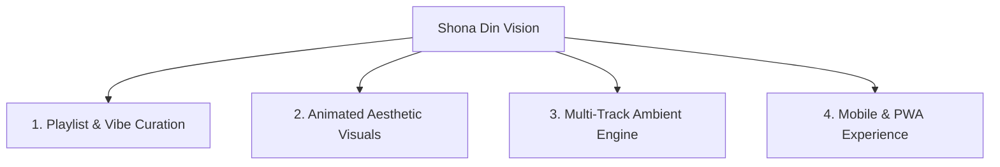

# 🗺️ SHONA DIN (সোনা দিন) — Future Roadmap & Vision

> *"Gaan noy, smriti shuni."* — A living digital archive for Bengali nostalgia.

This document outlines the planned feature enhancements, design evolutions, and technical milestones for **SHONA DIN**.

---

## 🎯 Key Objectives

---

## 🚀 Upcoming Features & Enhancements

### 🎵 1. Advanced Playlist & Content Management
- **Curated High-Vibe Playlists:**
  - Transition from general YouTube playlists to hand-curated, emotion-driven tracks matched strictly to specific nostalgic moods (e.g. *90s Doordarshan Serials*, *Late Night Rainy Adda*, *Old Radio Sunday Classics*).
- **Rich Track Metadata:**
  - Display exact artist, lyricist, composer, album cover art, and year of release for every playing song.
- **Dynamic Track Ordering & Shuffle:**
  - Allow users to shuffle, repeat, or skip without losing playlist context.
- **Custom Mixtape Creation:**
  - Let users save their favorite Bengali nostalgic tracks into personal "Mixtape Cassettes".

---

### ✨ 2. Animated Aesthetic & Visual Experience
- **Parallax Window Scenery Visualizers:**
  - **Bus & Train Journey:** Animated 2D pixel-art / vector scenery scrolling outside a rainy bus/train window.
  - **Brishtir Shondhya:** Realistic animated raindrops trickling down a warm-lit window glass.
  - **Dadu-r Radio:** Glowing vacuum tube filaments and animated tuning dial needle meters.
  - **Melar Shondhya:** Slow-spinning ferris wheel lights in twilight dusk.
- **Responsive Dynamic Themes:**
  - Automatic atmospheric gradient transitions based on real-world local time (Morning Akashbani sunrise, afternoon shade, late night tea stall warmth).
- **Interactive Audio Visualizers:**
  - Cassette reels spinning with real speed corresponding to playback, plus vintage LED VU audio meters reacting to sound frequencies.

---

### 🔊 3. Multi-Channel Soundscape Synthesizer
- **Customizable Ambient Sliders:**
  - Independent volume faders for background sound elements:
    - 🌧️ Rain & Thunder drops
    - 📻 Radio static & frequency tuning whistle
    - 💽 Vinyl crackle & needle noise
    - ☕ Tea stall cup clinking & street adda chatter
    - 🚆 Train rhythm & whistle

---

### 📱 4. Mobile & Progressive Web App (PWA)
- **Background Media Session Controls:**
  - Full support for lock-screen playback controls (play/pause/next/prev) and native system media notifications on iOS & Android.
- **Offline & Installable App:**
  - PWA support to install SHONA DIN as a standalone app on desktop and mobile devices.

---

## 🗓️ Phased Milestones

| Milestone | Target Focus | Key Deliverables |
| :--- | :--- | :--- |
| **Phase 1: Vibe & Playlist Polish** | Content & Curation | Handpicked track lists, detailed song metadata, lyrics overlay |
| **Phase 2: Animated Aesthetics** | Visual Experience | Window parallax scenes, audio VU meters, animated weather effects |
| **Phase 3: Ambient Mixing Deck** | Audio Engine | Multi-slider soundscape mixer, Web Audio API enhancements |
| **Phase 4: Mixtapes & PWA** | User Features | Custom mixtape builder, lock-screen media controls, PWA support |

---

> *Suggestions and contributions are welcome! Feel free to open an issue or pull request.*
